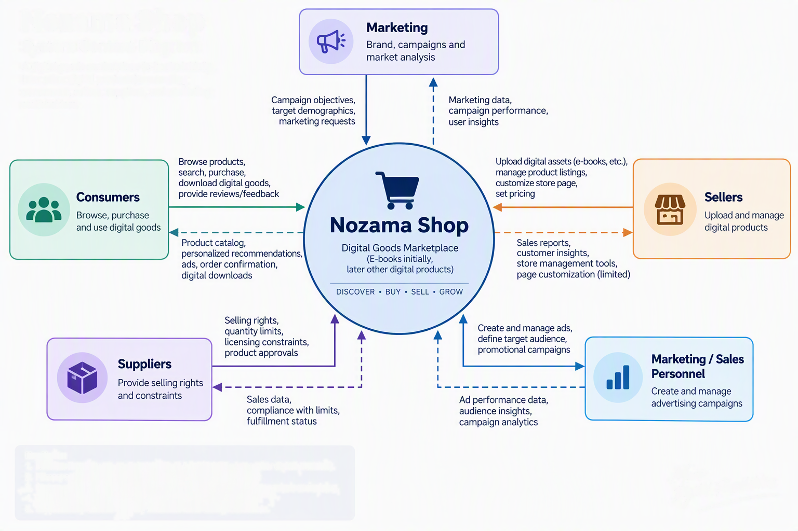

<h1> Software Requirements Specification </h1>

 <h2> For Nozama Shop </h2>

Version 0.1
Prepared by noobdev212@gmail.com

<h2> Revision History </h2>

| Name | Date | Description | Version |
| ---- | ---- | ----------- | ------- |
| noob212 | 15/10/2026 | Initial Planning Phase | v0.1.0 |
| noob212 | 16/10/2026 | Invisioning Chapter 2 | v0.1.1 |

<h2> Table of Contents </h2>

* [1. Introduction](#1-introduction)
    * [1.1 Document Purpose](#11-document-purpose)
    * [1.2 Product Scope](#12-product-scope)
    * [1.3 Definitions, Acronyms, and Abbreviations](#13-definitions-acronyms-and-abbreviations)
    * [1.4 References](#14-references)
    * [1.5 Document Overview](#15-document-overview)
* [2. Overall Description](#2-overall-description)
    * [2.1 Product Perspective](#21-product-perspective)
    * [2.2 Product Functions](#22-product-functions)
    * [2.3 Product Costraints](#23-product-costraints)
    * [2.4 User Characteristics](#24-user-characteristics)
    * [2.5 Assumptions and Dependencies](#25-assumptions-and-dependencies)
* [3. Requirements](#3-requirements)
    * [3.1 External Interfaces](#31-external-interfaces)
    * [3.2 Functional](#32-functional)
    * [3.3 Quality of Service](#33-quality-of-service)
* [4. Appendixes](#4-appendixes)

### 1. Introduction

#### 1.1 Document Purpose

This document was created for the purpose of identifying the project for what it is. To be transparent for anyone intrested on contributing or forking this project. The document will continuously update as long as there new phases of release.

#### 1.2 Product Scope

Zonama is a retail store for availability of digital products from anywhere around the world. It will be a website that handles retailer proprietary items in a platform to find the intended customers and to begin their business journey within the market. The mission is to capture the basis of selling, stocking, and buying to flourish a foundation for retailers within the platform.

#### 1.3 Definitions, Acronyms, and Abbreviations

| Term | Description |
| ---- | ----------- |

#### 1.4 References

These documents are referential materials that is used as motivitation:

* E-commerce 2016 business. technology. society. 12th edition (Kenneth C. Laudon, Carol Guercio Travor)

#### 1.5 Document Overview

To give further clarification for anyone using this documentation. We have written the description for each proceeding sections:

| Section No. | Description | Last Change |
| ----------- | ----------- | ----------- |
| 2           | The low and high level information about the product details | 15/10/2026 |
| 3           | Listing of functional requirements and the standard placed | 15/10/2026 |
| 4           | Extra information such as designs that isn't included on the previous sections | 15/10/2026 |

### 2. Overall Description

#### 2.1 Product Perspective

Nozama Shop is an e-commerce site that is loosely based on Amazon. Nozama cater towards cheap alternatives to digital assets. Those assests are limited to affordable ebooks as the primary product before branching out to other digital goods. The sellers, suppliers, consumers, marketing, and sales person are the target audience for this website. The application is expected to provide consumers the ability to buy goods from sellers. Sellers are able to market, conduct sales, and post the product in our application to attract the intend. As for third-party suppliers, we are prohibiting API based workflow as of the moment and replace it with the traditional upload to our servers. A diagram shown below, displays a birds eye view of the transaction that can be made by our users.

#### 2.2 Product Functions

#### 2.3 Product Costraints

The following constraints will be imposed:

- For our development, we will utilize `Django` and `Sqlite3` as our technology stack. In regards to the database, `Sqlite3` is only temporary as to meet with the necessary requirements within the set deadline `October 22, 2026 (Pre-Alpha)`. 
- Core aspect of the application such as consumer and seller transactions will be considered highest priority. Therefore, other features will be held limited as of the moment.
- Limited security with basic authorization and authentication with little encryption. This is to accommodate faster
implementation of core features.
- The lack of policies for the same reasons mention above, will impact verification of products being sold within the site.
- Currently limited to ebooks which can impact design on how the other features would integrate around the product.
- Third-party suppliers will only interact with system by subjecting tokens to restrict sellers who are given the authority to sell those products.
- Listed are the given roles that will be used by the system: `Admin`, `Consumer`, `Seller/Supplier`, and `Sales`.

#### 2.4 User Characteristics

#### 2.5 Assumptions and Dependencies

The key assumptions are:
- There will only be one `Admin` user to invoke application changes such as role change.
- Payment methods will not utilize banks except `PayMaya` and online wallet `GCash` as the only available option.
- Any AI/Machine learning algorithms utilize with the website will trained and tested using common training data.
- Unverified products will not be sold without the permitted token from the original owner.
- No separate Integration Management System (IMS) will be develop to manage products. Management will be limited to the website itself.
- To list your product as proof of ownership. The product must not be listed within the database of accredited owners. If the product is unlisted, ownership can be bought for the product which delegates the role of supplier to the owner. Ownership can  be shared or delegated for the role to anyone entursted by the owner.

### 3. Requirements

#### 3.1 External Interfaces

#### 3.2 Functional

#### 3.3 Quality of Service

### 4. Appendixes
